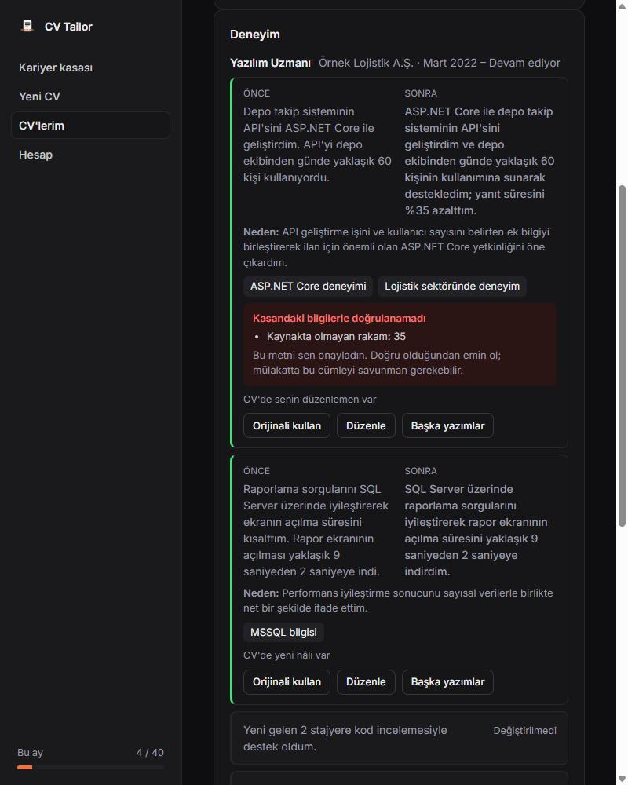
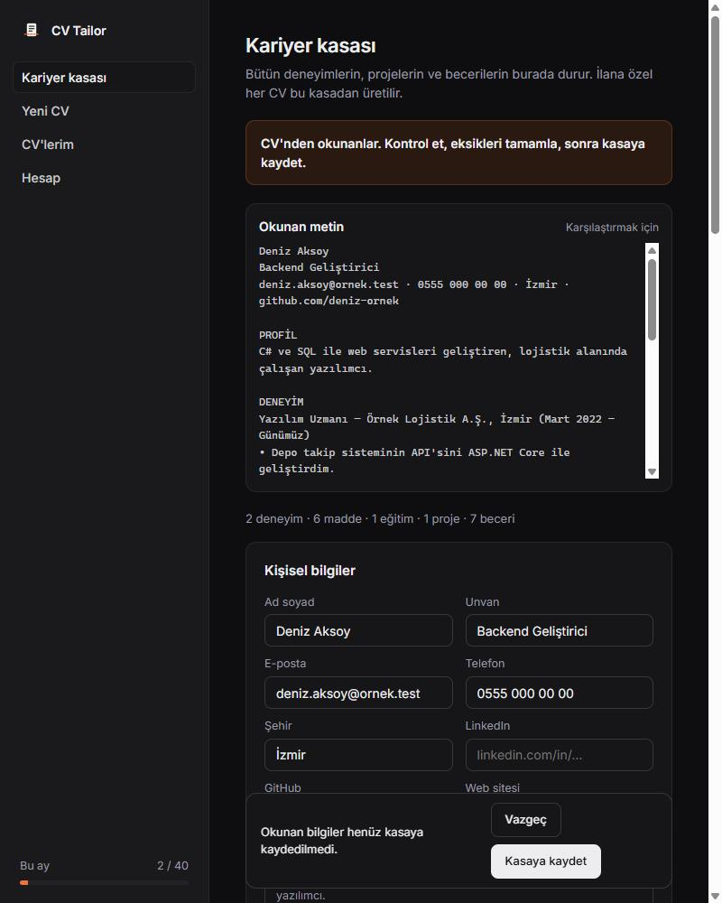
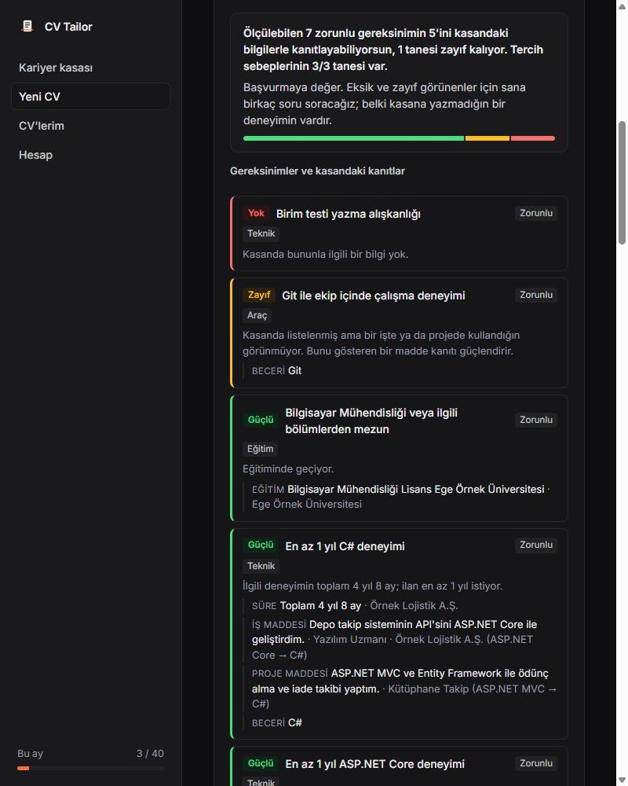
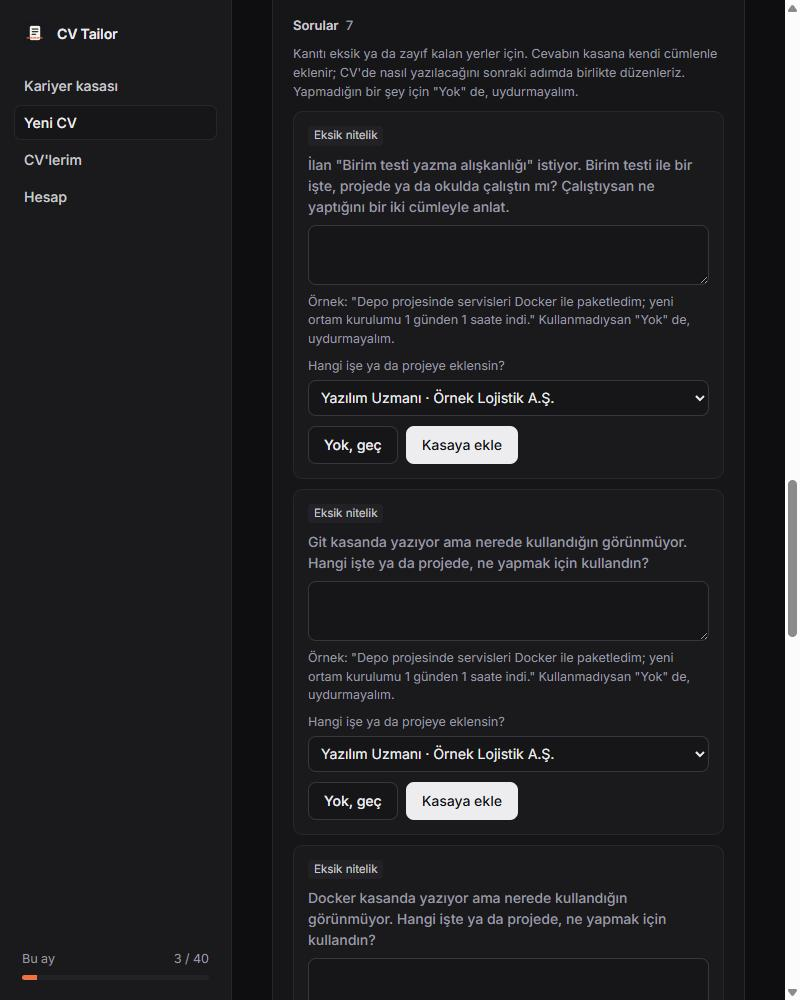
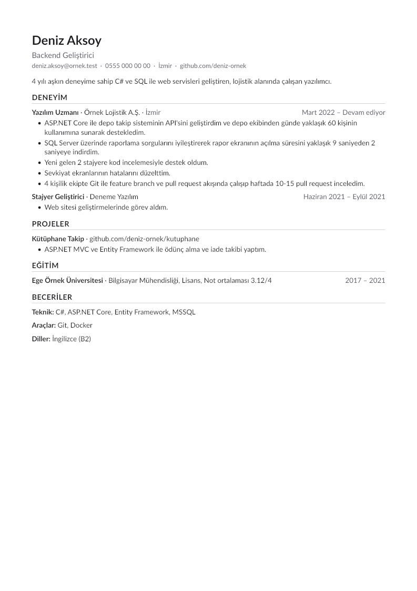

# CV Tailor

[](https://github.com/kursatcnk/cv-tailor/actions/workflows/tests.yml)

CV'ni başvuracağın ilana göre yeniden yazan bir çalışma alanı. CV'yi yüklüyorsun, ilanı yapıştırıyorsun; ilanın istediklerini CV'ndeki deneyimlerle eşleştiriyor, eksik kalanları sana soruyor ve ilana göre düzenlenmiş CV'yi PDF olarak geri veriyor. Her değişikliğin yanında nedeni yazıyor; amaç sadece CV'yi düzeltmek değil, iyi CV yazmayı öğretmek.

**Uydurmuyor.** CV'de olmayan bir deneyimi, rakamı ya da teknolojiyi eklemiyor. Yeni yazılan her madde dayandığı bilgiyi gösteriyor; kaynakta olmayan bir şey yazılırsa kod bunu yakalıyor ve sen onaylamadan CV'ye girmiyor.

ASP.NET Core 10 Web API + SQL Server arka uç, sade HTML/CSS/JavaScript arayüz. Site ve API aynı adreste çalışıyor.



## Nasıl çalışıyor

1. **CV'ni yükle.** PDF, DOCX ya da metin. Bölümlere ayrılıyor, okunan metinle yan yana kontrol edip kasana kaydediyorsun.
2. **Hedefi seç.** İlanı yapıştır ya da ilan yoksa meslek ve seviye seç.
3. **Eşleşmeye bak.** İlandaki her gereksinimin karşısında kasandaki kanıt ve gücü: güçlü, zayıf, yok.
4. **Soruları cevapla.** Eksik ya da zayıf kalanlar ve rakamsız maddeler için kısa sorular. Cevapların kasaya kendi cümlenle ekleniyor; "yok" dersen o konu için madde üretilmiyor.
5. **Provayı yap.** Her madde önce/sonra yan yana, nedeniyle birlikte. Kabul et, orijinali kullan, düzenle ya da başka bir yazımı seç.
6. **PDF'i indir.** Tek sütunlu, işe alım sistemlerinin (ATS) sorunsuz okuduğu bir şablon.

## Özellikler

- **CV içe aktarma:** PDF (iki sütunlu şablonlar sütun sütun okunuyor), DOCX ve yapıştırılmış metin. Bazı PDF'lerde kaybolan bitişik harfler ("ti", "fi") işaretlenip tamamlanıyor. AI anahtarı yoksa iletişim bilgileri doldurulup form açılıyor.
- **Kariyer kasası:** Bütün deneyimler, projeler ve beceriler tek yerde. İlana özel her CV buradan üretiliyor; kasada düzelttiğin bilgi sonraki CV'lere yansıyor.
- **İlan çözümleyici:** Pozisyon, seviye, zorunlu ve tercih edilen gereksinimler, iş tanımı, anahtar kelimeler. Yan haklar ve şirket tanıtımı gereksinim sayılmıyor.
- **Meslek modu:** İlan yoksa Backend, Frontend, Muhasebe, Satış ya da İK için elle hazırlanmış profiller; seviyeye göre gereksinimler, o meslekte CV yazma ipuçları ve kötü/iyi madde örnekleri. AI hakkı harcamıyor.
- **Gereksinim–kanıt matrisi:** Kodla hesaplanıyor, AI kullanmıyor. Eş anlamlılar sözlüğü (`MSSQL` = `SQL Server`, `GitHub Actions` → `CI/CD`), Türkçe ekler ("Excel'de", "muhasebede"), "en az 3 yıl" şartında çakışan işleri bir kez sayan süre hesabı.
- **Sorular ve rakam avcısı:** Hangi sorunun sorulacağına kod karar veriyor. Rakam sorusunun cevabı ait olduğu maddeye bağlanıyor ve CV'de onunla tek madde oluyor.
- **Yeniden yazım:** "Ne yaptım + nasıl + sonuç" yapısında, ilan kelimeleri doğal yerleşmiş maddeler, her biri için iki alternatif ve öğretici bir neden. İlgisiz içerik çıkarılıyor, CV tek sayfaya sığdırılıyor; neyin neden çıktığı yazıyor.
- **Uydurma koruması:** Aşağıda.
- **Kişisel veri:** Ad, e-posta, telefon, linkler, TC kimlik no ve IBAN AI'a gitmeden yer tutucuyla değiştiriliyor, cevapta geri konuyor. CV'de TC kimlik no ya da tam ev adresi varsa uyarı çıkıyor. Hesabı silince kasa, ilanlar ve CV'ler dahil her şey siliniyor.
- **Hesap ve kota:** Kayıt, e-posta doğrulama, şifre sıfırlama, aylık AI kotası (aynı anda gelen isteklerle bile aşılamıyor). JWT httpOnly çerezde, CSRF koruması, istek sınırları.
- **Yedek motor:** AI anahtarı yoksa ya da sağlayıcı hata verirse ekran boş kalmıyor: ilan madde işaretli satırlardan çözümleniyor, CV yeniden yazılmadan sadece seçilip sıralanıyor.

## Uydurma koruması nasıl çalışıyor

Kasadaki her madde bir kimlik taşıyor. AI'a maddeler kısa etiketlerle (`f1`, `f2`) gidiyor ve yazdığı her yeni madde hangi etiketlerden türediğini söylemek zorunda. Cevap gelince kod, yeni maddeyi kaynak maddeleriyle karşılaştırıyor:

- Yeni maddedeki her **rakam** kaynakta geçiyor mu? (`1.500` ile `1500` aynı sayı)
- Sözlükteki **teknoloji ve ilan terimleri** kaynakta ya da eşdeğeri olarak geçiyor mu? İlanın istediği ama senin yazmadığın "Docker" maddeye eklenmişse yakalanıyor.
- Cümle ortasında büyük harfle yazılmış **özel adlar** (şirket, ürün) kaynakta var mı?
- Kaynakta olmayan bir **yönetim/liderlik iddiası** ("ekibi yönettim") var mı?

Birine takılan madde "onay bekliyor" olarak işaretleniyor ve sen onaylamazsan CV'ye orijinali basılıyor. Provada elle düzelttiğin metin de aynı kontrolden geçiyor.

## Ekran görüntüleri

| Kasa: okunan metin ve kontrol | Eşleşme |
|---|---|
|  |  |
| **Sorular** | **PDF çıktısı** |
|  |  |

Görüntülerdeki kişi, şirketler ve ilan kurgusaldır.

## Kurulum

Gerekenler: [.NET 10 SDK](https://dotnet.microsoft.com/download/dotnet/10.0) ve SQL Server (Express yeterli).

```bash
git clone https://github.com/kursatcnk/cv-tailor.git
cd cv-tailor
dotnet run --project src/CvTailor.Api --launch-profile http
```

Tarayıcıda `http://localhost:5310` açılır. Veritabanı tabloları ilk açılışta kendiliğinden oluşur.
Bağlantı adresi `src/CvTailor.Api/appsettings.json` → `ConnectionStrings:DefaultConnection` içinde (varsayılan `localhost\SQLEXPRESS`).

Visual Studio ile: `CvTailor.sln` → `CvTailor.Api` → profil olarak **http** → `Ctrl+F5`.

### AI anahtarı

Anahtar olmadan da çalışır (yukarıdaki yedek motorla). Gerçek AI için en az bir anahtarı **user secrets** ile ekle; proje klasörünün dışında durur, GitHub'a gitmez:

```bash
dotnet user-secrets set "AI:Gemini:ApiKey" "..." --project src/CvTailor.Api
```

Desteklenenler: `AI:Anthropic:ApiKey`, `AI:OpenAI:ApiKey`, `AI:Gemini:ApiKey`, `AI:DeepSeek:ApiKey`. Birden fazlası varsa `AI:Preferred` ile seçilir, yoksa tanımlı ilk sağlayıcı kullanılır. Model adları `appsettings.json` → `AI` bölümünde.

### E-posta

SMTP ayarı yoksa mailler gönderilmez, içerikleri (doğrulama kodu, sıfırlama linki) terminale yazılır. Gerçek gönderim için `Email:Smtp:Host`, `Port`, `Username`, `Password` ve `From` değerlerini aynı şekilde user secrets ile ekle.

## Testler

```bash
dotnet test
```

130'u aşkın test; her push'ta GitHub Actions'ta çalışıyor. Veritabanı ve AI gerektirmiyor:

- Eşleştirici, eş anlamlılar ve Türkçe ekler, süre hesabı
- Uydurma koruması (rakam, terim, özel ad, liderlik iddiası)
- Kişisel veri maskeleme; sahte bir AI sağlayıcısıyla "AI'a giden metinde ad ve e-posta yok" kontrolü
- Soru planlama, tek sayfa yerleşimi, meslek profillerinin bütünlüğü
- Üretilen PDF'in metne geri çevrilince bozulmadığı (Türkçe karakterler, bölüm sırası)
- Test sırasında üretilen kurgusal iki sütunlu PDF ve DOCX'lerle CV okuma

## Proje yapısı

```
src/CvTailor.Api
├── Controllers/            Auth, Account, Vault, Cv (içe aktarma), Targets, Cvs
├── Services/
│   ├── Cv/                 metin çıkarma, AI ile ayrıştırma, normalleştirme, kasa
│   ├── Targets/            ilan çözümleyici, meslek profilleri
│   ├── Matching/           eşleştirici, eş anlamlılar sözlüğü, süre hesabı
│   ├── Interview/          sorular ve cevaplar
│   ├── Tailoring/          seçim ve sayfa yerleşimi, yeniden yazım, uydurma koruması, PDF
│   ├── Privacy/            kişisel veri maskeleme ve uyarıları
│   └── Ai/                 Anthropic, OpenAI, Gemini, DeepSeek sağlayıcıları
├── Knowledge/              synonyms.json, professions/*.json
└── wwwroot/                arayüz
tests/CvTailor.Tests        xUnit
```

## Teknolojiler

ASP.NET Core 10, Entity Framework Core 10, SQL Server, PdfPig (PDF okuma), DocumentFormat.OpenXml (DOCX okuma), QuestPDF (PDF üretme), xUnit, GitHub Actions.

## Lisans

MIT
